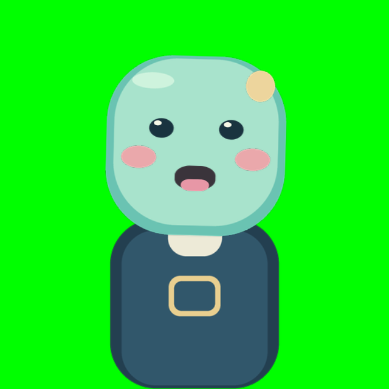

# 検証結果

## 暗号化通信対応後の再検証（2026-10-25）

対象はコミット[`a5e6f4b`](https://github.com/samiosu/spritestudio_facetrack_live/commit/a5e6f4b904e14ded87b9934d64aa8eb7b9301361)です。
Linuxはこの作業環境で新規にReleaseビルドして実行しました。
Windows・Android・iOSは、同じコミットに対する2026-10-23のGitHub Actions実行結果を照合しています。

| 対象 | 確認結果 |
| --- | --- |
| Linuxビルド | Debian 13／GCC 14.2／CMake 4.4.4でGUI・受信CLIのReleaseビルド成功。OpenSSL 3.5.7を使用 |
| 自動テスト | CTest 5件すべて成功。受信コア、Python、Python/C++暗号化UDP相互運用、保存済みライセンスのハッシュ、SDKパス処理を確認 |
| Python | 11件成功。暗号化・平文／改ざん／別鍵の拒否、hello再送、相手不在時の復帰、OpenSeeFace変換など。Python 3.12.14／cryptography 50.0.2で実行 |
| GUI描画 | Xvfbとソフトウェア描画で実際に起動し、SSPJ／SSAE／SSCE／PNGの読み込み、顔の値による画素変化、OpenGLエラーなしを確認 |
| SF2送信から描画 | 別プロセスの`tools/send_demo.py`からAES-GCMで送信。GUIで8フレーム受信・拒否0件、通常表情からの描画変化を確認。送受信プロセスは正常終了 |
| OpenSeeFace変換から描画 | 合成したOpenSeeFace形式の入力→別プロセスの変換アダプター→SF2→GUIで確認。8フレーム受信・拒否0件、描画変化と正常終了を確認 |
| インストール配置 | `cmake --install`で配置したアプリを`/tmp`から起動し、同梱デモの読み込み・描画成功 |
| Windows CI | Releaseビルド、CTest 5件、インストール成功。実画面での描画は未確認 |
| Android CI | APKビルド、単体テスト8件成功。失敗・エラー・スキップ0件。lintはエラー0・警告19件。取得したレポートのSHA-256も照合 |
| iOS CI | SimulatorのアプリビルドとXCTest 4件が成功。4件すべての成功と失敗0件を実行ログで確認 |

SDKヘッダー等のコンパイラ警告は残っています。アプリのコード修正は必要ありませんでした。
保存した第三者ライセンス／通知60件の原文ハッシュは一致しています。

今回照合したGitHub Actions:

- [Desktop（Windows／Linux）](https://github.com/samiosu/spritestudio_facetrack_live/actions/runs/39941259560)
- [Android](https://github.com/samiosu/spritestudio_facetrack_live/actions/runs/39941259531)
- [iOS](https://github.com/samiosu/spritestudio_facetrack_live/actions/runs/39941259409)

以下は合成データをSF2で送信した際の、実際のキャラ表示ウィンドウです。
カメラによる顔認識やスマホ実機での確認を示すものではありません。

実カメラ、スマホ実機、実際のWi-Fi、ユーザーのキャラ、OBSでの最終配信は引き続き確認が必要です。
バイナリ公開前のモバイル内部依存のライセンス確認も残っています。

## 初回検証（2026-10-13）

2026-10-13時点のローカル検証と、PrivateリポジトリのGitHub Actionsでの検証です。

| 対象 | 結果 |
| --- | --- |
| Linux C++ビルド | GCC 14.2 / CMake 4.4でGUI・受信CLIのビルド成功 |
| PCのGitHub Actions | Ubuntu 24.04／Windows Server 2022でReleaseビルド、CTest 4件、インストール成功。LinuxはGUI描画のスモークテストも成功 |
| C++テスト | 入力検証、UDP hello/ready、重複・順序逆転・シーケンス周回、peer切替、停止、平滑化が成功 |
| Pythonテスト | OpenSeeFace変換と合成送信の8件が成功 |
| SDK描画 | 独自デモのSSPJ/SSAE/SSCE/PNG読込、表情による画素変化、GLエラーなし |
| SDKパス処理 | Release＋`_FORTIFY_SOURCE=3`で長いパス・日本語・存在しないパス・作業ディレクトリ不変の回帰テスト成功。元SDKのバッファ検出による異常終了を再現し、修正後のGUI描画も成功 |
| UDPからSDK描画 | 別プロセスの合成送信で8フレーム受信・拒否0、通常表情と描画の差を確認 |
| メッシュ／ボーン | 公式SDKのローカルサンプルで読み込み・通常描画を確認。サンプル素材は同梱していない |
| ライセンス表示 | 保存した60件の原文／通知のSHA-256を確認 |
| Android | SDK35 / JDK17 / Gradle8.11.1でAPKビルド、単体テスト7件がローカルとCIで成功。CIのlintはエラー0・警告19件 |
| Android統計logger | ビルド後のbytecodeでno-op loggerへの置換を確認。通信の実機キャプチャ検証は未実施 |
| iOS | iPhone 16 Pro／iOS Simulator 18.6（x86_64）でアプリビルドとXCTest 3件がCIで成功。失敗・スキップ0件 |

GitHub Actionsの実行記録:

- [PC（Windows／Linux）](https://github.com/samiosu/spritestudio_facetrack_live/actions/runs/38352171818)
- [Android](https://github.com/samiosu/spritestudio_facetrack_live/actions/runs/38352171822)
- [iOS](https://github.com/samiosu/spritestudio_facetrack_live/actions/runs/38353822046)

Linuxの描画確認にはXvfbとMesa llvmpipeのソフトウェア描画を使用しました。
Windowsの実画面での描画とmacOSのPCビルドは未検証です。
実際のPC GPUとの性能比較やUnityとの速度・メモリ比較は行っていません。

実機のAndroid／iPhoneカメラ、表情の方向、QR読取、LAN権限、Wi-Fiの遅延、
バッテリー消費、OBSでの最終配信は確認が必要です。ユーザーの実キャラも未提供のため、
そのキャラの見た目やパーツ割り当ては未検証です。

モバイルのMediaPipe JNI/frameworkに静的結合された内部依存の完全な表示は、
公開バイナリの配布前に確認します。直接依存・確認済みAndroid依存の表示とハッシュは
`licenses/manifest.json`にあります。ソース公開の準備と公開APKの準備は区別します。
